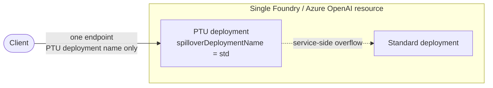
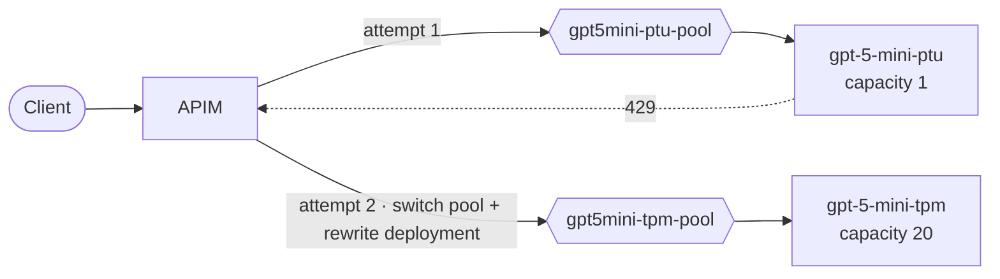
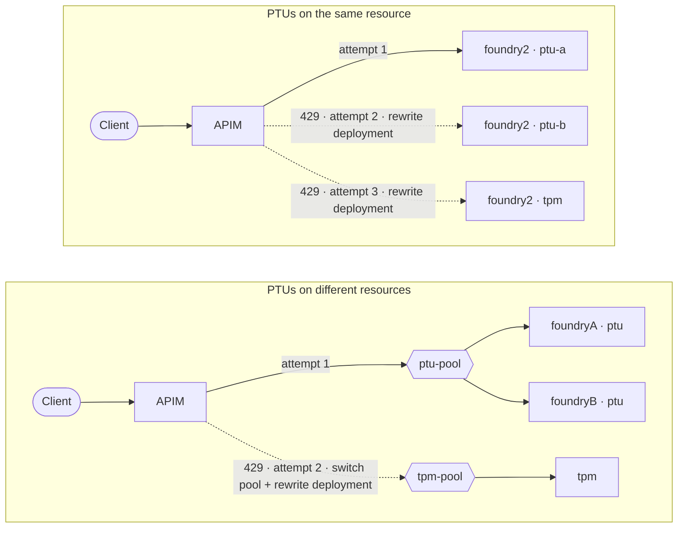
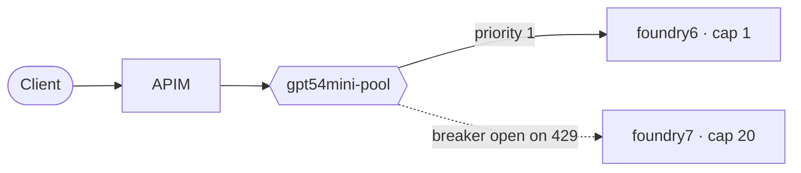

# Part 2 — PTU → TPM failover options

The ways a PTU (Provisioned Throughput Unit) primary can spill over to a TPM (Standard / PayGo, token-per-minute) secondary that are worth actually considering.

> Status: working document. Scenarios 2 and 3 are implemented in [policy.xml](labs/model-routing/policy.xml) / [main.bicep](labs/model-routing/main.bicep); the rest are candidates. Behavioral claims about APIM and Foundry were checked against Microsoft Learn on 2026-10-12 and are linked inline.
>
> The catalogue is curated, not exhaustive. Patterns that address a *different* problem — gateway HA via Front Door, weighted blue/green pools — are deliberately excluded or demoted to [§5](#5-cross-cutting-concerns) so that every numbered scenario is a genuine alternative to the others.

---

## 1. Why failover is needed at all

A provisioned deployment has a **fixed** throughput ceiling. <u>**When concurrent load pushes utilization past 100%**</u>, Azure OpenAI / Foundry rejects the call:

| Signal | PTU (Provisioned*) | TPM (Standard / Global Standard) |
|---|---|---|
| Throttle status | `429 Too Many Requests` | `429 Too Many Requests` |
| Retry hint header | `retry-after` (seconds) and `retry-after-ms` (milliseconds) | Service/API dependent; honor `Retry-After` / `retry-after-ms` when returned |
| Cause | `provisioned-managed utilization` at capacity | tokens-per-minute / requests-per-minute quota |
| Cost model | Fixed — hourly PTU rate, or prepaid via a **reservation** (see [Appendix B](#appendix-b--how-reservations-factor-into-the-cost)) | Per-token, metered |

The whole point of spillover: **keep the cheap, predictable PTU saturated, and only overflow the excess to pay-as-you-go.** Failing over too eagerly wastes the PTU you already paid for.

\* Three provisioned SKUs exist. Their principal behavioral difference here is **where inference is allowed to run** — all three throttle identically, so every gateway-side pattern below applies unchanged to each:
>
> | SKU | Scope |
> |---|---|
> | `ProvisionedManaged` | **Regional** — geography-constrained processing; verify the applicable regional residency terms |
> | `DataZoneProvisionedManaged` | **Data zone** — e.g. US or EU |
> | `GlobalProvisionedManaged` | **Global** — any region with capacity |
>
> See [Appendix A](#appendix-a--ptu-sku-scopes-compared) for the full comparison and what it means for choosing a spillover target.

---

## 2. The design space

Every option is a point in this space:

| Dimension | Choices |
|---|---|
| **Where the decision is made** | Client SDK · APIM policy · APIM backend pool · Foundry platform (native spillover) · DNS/traffic layer |
| **Topology** | Two deployments on one resource · Two resources same region · Two resources cross-region · Cross-subscription/tenant |
| **Failover granularity** | Same request retried · Subsequent requests rerouted (circuit breaker) · Percentage split (weighted) |
| **Trigger** | HTTP 429 only · 429 + 5xx · timeout · utilization metric · token-budget exhaustion |
| **State** | Stateless per request · Stateful (breaker open for a TTL) |
| **Streaming safe?** | Yes (pre-first-byte only) · No (cannot retry mid-stream) |

---

## 3. Scenario catalogue

### Scenario 1 — Platform-native provisioned **spillover** (no gateway involved)

Foundry can route a provisioned deployment's overage to a standard deployment itself. The PTU and standard deployments live on the **same Foundry / Azure OpenAI resource**, so they share **one endpoint** and one set of credentials. Client and gateway call only the **PTU deployment name**; the service, not the caller, picks the spillover target. See <a href="https://learn.microsoft.com/azure/foundry/openai/how-to/spillover-traffic-management" target="_blank" rel="noopener noreferrer">Manage traffic with spillover for provisioned deployments</a>.



- **Same endpoint, one deployment name:** the request targets `/openai/deployments/<ptu-name>/…` (or `model` = `<ptu-name>` on the v1 API). The standard deployment is never named in the call; it is reached only by the service-side overflow. It is still addressable under the same endpoint if you call it directly, but spillover does not use that path.
- **Enable it** one of two ways: set the deployment property `spilloverDeploymentName`, or set the per-request header `x-ms-spillover-deployment`. If both are present, the deployment property wins.
- **Trigger:** specific documented failures from the provisioned deployment — `429` when PTUs are exhausted, `500` or `503` server errors, and `400` for documented unsupported long-context cases.
- **Prerequisites:** the current Microsoft page requires a provisioned managed deployment and a standard deployment in the **same** Foundry/Azure OpenAI resource, with an active standard deployment that matches the provisioned deployment's **model and version**, and recommends enabling spillover for **global and data zone** provisioned deployments. The earlier preview page was stricter: a global or data zone provisioned primary, a global or data zone standard target, and a matching data-processing level (for example, global provisioned with global standard). Neither page explicitly confirms regional `ProvisionedManaged` support — treat it as unconfirmed and verify before relying on it.
- **Observability is good, not poor:** spilled responses carry `x-ms-spillover-from-deployment` (the PTU name), `x-ms-deployment-name` (who actually served it), and `x-ms-spillover-error` (the originating status code). In Azure Monitor, split `Azure OpenAI Requests` by `ModelDeploymentName`, `StatusCode`, and `IsSpillover`.
- **Cost:** provisioned-served requests incur only the hourly PTU cost; spilled requests are billed at standard per-token rates.
- **Cons:** same-resource only, so no cross-region or cross-resource control, and no gateway-level governance of the split. Availability varies by model/region and some pages still carry a Preview banner — verify before demoing.

**NOTE:** this is the "you may not need the gateway for this" counterpoint. This sample has no PTU, so it cannot be demonstrated here without buying provisioned capacity.

> **Why this one is listed first.** It is the cheapest correct answer when you qualify for it: no policy, no extra backend, no breaker to tune, and the same request can be saved when the standard deployment succeeds. Reach for a gateway pattern (Scenarios 2 and 3) only when a prerequisite rules this out — a regional `ProvisionedManaged` primary (native support unconfirmed), a spillover target on a different resource or region, or a need for gateway-level governance of the split.

### Scenario 2 — Policy retry across two single-member pools, two deployments on ONE Foundry resource ✅ implemented

`gpt-5-mini-ptu` → `gpt-5-mini-tpm` on the <u>**same**</u> `foundry2` endpoint, each fronted by its own backend pool
(`gpt5mini-ptu-pool` → `gpt5mini-tpm-pool`), switched by an explicit `<retry>`. **No circuit breaker.**



**Policy** — excerpt of [policy.xml](labs/model-routing/policy.xml); the same file also stamps the `x-served-*` headers in `<outbound>`:

```xml
<inbound>
  <base />
  <!-- requestedModel is resolved earlier from the URL deployment-id or the body "model" -->
  <choose>
    <when condition="@(((string)context.Variables["requestedModel"]) == "gpt-5-mini")">
      <set-backend-service backend-id="gpt5mini-ptu-pool" />      <!-- attempt 1 -->
      <set-variable name="miniAttempt" value="@(0)" />
    </when>
  </choose>
</inbound>
<backend>
  <choose>
    <when condition="@(((string)context.Variables["requestedModel"] ?? string.Empty) == "gpt-5-mini")">
      <retry condition="@(context.Response != null && context.Response.StatusCode == 429 && (int)context.Variables["miniAttempt"] < 2)"
             count="1" interval="1" first-fast-retry="true">
        <set-variable name="miniAttempt" value="@((int)context.Variables["miniAttempt"] + 1)" />
        <set-variable name="miniDeployment" value="@(((int)context.Variables["miniAttempt"]) == 1 ? "gpt-5-mini-ptu" : "gpt-5-mini-tpm")" />
        <set-variable name="miniPool" value="@(((int)context.Variables["miniAttempt"]) == 1 ? "gpt5mini-ptu-pool" : "gpt5mini-tpm-pool")" />
        <set-backend-service backend-id="@((string)context.Variables["miniPool"])" />
        <!-- Chat Completions carries the deployment in the path -->
        <rewrite-uri template="@{
            string p = context.Request.OriginalUrl.Path;
            int idx = p.IndexOf("/openai");
            string tail = idx >= 0 ? p.Substring(idx) : p;
            tail = tail.Replace("/deployments/gpt-5-mini/", "/deployments/" + (string)context.Variables["miniDeployment"] + "/");
            string qs = context.Request.OriginalUrl.QueryString ?? string.Empty;
            if (qs.StartsWith("?")) { qs = qs.Substring(1); }
            return string.IsNullOrEmpty(qs) ? tail : (tail + "?" + qs);
        }" />
        <!-- Responses API carries it in the body "model" -->
        <set-body>@{
            var body = context.Request.Body.As<JObject>(preserveContent: true);
            if (body["model"] != null) { body["model"] = (string)context.Variables["miniDeployment"]; }
            return body.ToString();
        }</set-body>
        <forward-request buffer-request-body="true" />
      </retry>
    </when>
    <otherwise><forward-request /></otherwise>
  </choose>
</backend>
```

- **Decision point:** `<retry>` inside `<backend>`, doing two things per attempt — `set-backend-service` to the
  attempt's pool, *and* rewriting the URL path plus the body `model` field.
- **Granularity:** the *same* request can be recovered when the secondary succeeds and the request is safe to replay.
- **Why there is no circuit breaker:** the retry names its target explicitly, so breaker state is never consulted.
  A breaker would actively hurt here: each pool has exactly one member, so a tripped member leaves the pool with
  nothing to route to, and the `PT1M` open window would keep rejecting a PTU you are paying for by the hour.
- **The pools are semantic, not functional.** Both pools resolve to the *same* `foundry2` host, because deployments
  are resource-scoped while APIM backends are host-scoped — see
  [Part 1a1-DeploymentIsResourceScoped.md](Part%201a1-DeploymentIsResourceScoped.md). The `rewrite-uri` + body
  rewrite is what actually performs the failover. What the pools buy you is a named PTU path and a named TPM path
  that show up in APIM metrics/traces as distinct backends, and a seam to later add a real second resource to
  either pool without touching the policy. Do not mistake the pool switch for the mechanism.
- **Observability:** the outbound section stamps `x-served-deployment`, `x-served-pool` and `x-served-attempts`
  on the response, so a demo can prove which side served the call.
- **Pros:** cheapest topology (one resource and endpoint), no extra region, deterministic, no breaker TTL
  to tune.
- **Quota note:** the topology still needs both provisioned capacity and sufficient Standard TPM quota; sharing a
  resource does not make those the same quota pool.
- **Cons:** custom policy to maintain; body buffering required (`buffer-request-body="true"`); the pool layer adds
  indirection that does no routing work today; does not help if the whole resource/region is down.

> A single-member pool and two pools referencing the same backend are what this lab deploys — the ARM reference lists no minimum length for `pool.services` (and Microsoft Learn states
> a pool can hold up to 30 backends); membership is a list of references to existing backends.

<br />

<details>
<summary><b>Variant — two PTU deployments falling over to one TPM deployment</b> (not implemented) — click to expand</summary>

Scenario 2 stretches to "PTU-A and PTU-B overflow into one shared TPM deployment", but whether the pools earn their keep depends on **where the two PTUs live**. The deciding fact is the same one as above: deployments are resource-scoped, APIM backends are host-scoped.

| | PTUs on **different** resources | PTUs on the **same** resource |
|---|---|---|
| **Does the pool do real routing?** | **Yes** — the PTU pool has two members on two hosts, so round-robin / weighted / priority actually selects between them | **No** — both PTUs resolve to one host, so the pool cannot pick a deployment. Pools stay semantic, exactly as in Scenario 2 |
| **Who picks PTU-A vs PTU-B** | The pool | The policy (`rewrite-uri` + body `model` rewrite, e.g. alternate per request) |
| **Circuit breaker on PTU members** | Reasonable — one member tripping leaves the other serving | Not applicable — there are no separate hosts to trip |
| **Failover chain** | PTU pool → TPM pool (`count="1"`) | PTU-A → PTU-B → TPM (`count="2"`), each attempt rewriting the deployment |
| **Net improvement over Scenario 2** | **Yes** — effectively Scenario 3 for the PTU tier plus Scenario 2's explicit retry for the TPM tier (i.e. [Scenario 3b](#scenario-3b--pool--retry-to-also-recover-the-triggering-request) with a TPM step) | **None from pools** — you only add one more explicit attempt to the policy |



- **Check the all-tripped case (different resources).** If both PTU members have an open breaker, the pool has nothing left to route to. The status APIM returns then is not documented in this repo; if it is not `429`, the retry condition must include it or the request never reaches the TPM tier.
- **The TPM deployment is a shared sink.** PTU peaks tend to coincide, so size its quota for the *sum* of both overflows. Its own `429` is the end of the line.
- **Attribution.** `x-served-pool` / `x-served-deployment` must identify which PTU spilled, otherwise the overflow cost cannot be traced back to its source.
- **Policy rework.** The sample hard-codes `miniAttempt < 2` and two pools; a longer chain means turning that into an ordered list of targets.
- **Different models are a different problem.** If the two PTUs serve *different* models, one TPM deployment can only stand in for one of them — that is [Scenario 6](#scenario-6--model-substitution-fallback-degrade-dont-fail) (degrade, don't fail), not a tier failover.
- **Check Scenario 1 first.** If both PTUs qualify and share a resource with the TPM deployment, native spillover may remove the need for any of this. Whether two PTUs can share one spillover target is not confirmed here — verify before relying on it.

</details>

### Scenario 3 — Native backend pool + circuit breaker, two resources ✅ implemented

`gpt-5.4-mini` on `foundry6` (priority 1) and `foundry7` (priority 2), grouped in `gpt54mini-pool`.



**Policy** — almost nothing. The failover logic lives in the backend resources, not in policy ([policy.xml](labs/model-routing/policy.xml)):

```xml
<inbound>
  <base />
  <choose>
    <when condition="@(((string)context.Variables["requestedModel"]) == "gpt-5.4-mini")">
      <set-backend-service backend-id="gpt54mini-pool" />
    </when>
  </choose>
</inbound>
<backend>
  <forward-request />   <!-- bare forward: no retry, so the 429 that trips the breaker reaches the caller -->
</backend>
```

**Backend config** — where the behaviour actually comes from ([inference-api.bicep](modules/apim/v3/inference-api.bicep), pool members from [params.json](labs/model-routing/params.json)):

```bicep
// On each of foundry6 and foundry7 (backend resource properties)
circuitBreaker: {
  rules: [
    {
      name: 'InferenceBreakerRule'
      failureCondition: {
        count: 1
        interval: 'PT1M'
        errorReasons: [ 'Server errors' ]
        statusCodeRanges: [ { min: 429, max: 429 } ]
      }
      tripDuration: 'PT1M'
      acceptRetryAfter: true
    }
  ]
}

// gpt54mini-pool (a backend of type Pool)
type: 'Pool'
pool: {
  services: [
    { id: '/backends/foundry6', priority: 1 }
    { id: '/backends/foundry7', priority: 2 }
  ]
}
```

- **Decision point:** APIM backend pool (`type: Pool`, per-member `priority`) + per-backend `circuitBreaker` tripping on one 429 within `PT1M`, open for `PT1M`, `acceptRetryAfter: true` (a `Retry-After` header on the response can change the effective wait — see [Breaker TTL tuning](#breaker-ttl-tuning)).
- **Granularity:** *subsequent* requests only. Microsoft documents that lower-priority groups are used "when all backends in higher priority groups are unavailable because circuit breaker rules are tripped" — so the 429 that trips the breaker is returned to the caller. There is no automatic same-request failover.
- **Pros:** declarative, no custom policy, and can also respond to configured backend failure conditions during a resource or region outage.
- **Cons:** needs two resources (two quota allocations); one request is sacrificed on every trip, and the first request after the configured trip duration can fail and retrip the breaker; a 1-minute open window can starve a PTU you're paying for.
- **Selection modes documented:** round-robin, weighted, priority-based. No latency-aware routing or active health probes are documented — a tripped breaker is the only documented "unhealthy" signal.
- **Documented constraints:** the backend circuit breaker is not supported on the Consumption tier, only one breaker rule can be configured per backend, and breaker tripping and pool load balancing are approximate because gateway instances do not synchronize state. "One request sacrificed per trip" is therefore a typical outcome, not a guarantee.

> On a **standalone** backend (not in a pool), an open breaker makes APIM return `503 Service Unavailable` rather than the backend's own 429. Inside a pool the request falls through to the next priority group instead.

> **On weights.** The same pool also accepts `weight` instead of (or inside) priority groups — a 90/10 split, say. That is the right tool for blue/green rollout, but it is the *wrong* tool for PTU spillover: a static weight sends paid-for PTU capacity to PayGo before the PTU is saturated, and it guesses at a ratio that Scenarios 4 and 5 derive from an actual signal. Use weights to shift traffic between versions, not to overflow a PTU.

> **Why Scenarios 2 and 3 are separate, not combined.** They are alternative mechanisms for the same job, and they are kept apart in the lab so the contrast stays visible.
>
> | | Scenario 2 | Scenario 3 |
> |---|---|---|
> | **Topology** | Two deployments on **one** resource | One deployment on **two** resources |
> | **Failover trigger** | Explicit `<retry>` naming its target | Pool priority + circuit breaker |
> | **Circuit breaker** | None — it would leave a single-member pool with nothing to route to and keep rejecting a PTU you pay for by the hour | Required — the only "unhealthy" signal the pool has |
> | **Same request recovered** | Yes, if the secondary succeeds | No — the 429 that trips the breaker goes back to the caller |
>
> Adding Scenario 3's breaker to Scenario 2 would hurt it. The two ideas do combine in **Scenario 3b** (pool + breaker + explicit retry) and as a different-region secondary; see the [comparison matrix](#4-comparison-matrix).

### Scenario 3b — Pool + retry, to also recover the triggering request

Same pool and breaker rule as Scenario 3 (backend config unchanged), plus a `<retry>` on 429. Microsoft's documented <a href="https://learn.microsoft.com/azure/api-management/retry-policy#examples" target="_blank" rel="noopener noreferrer">"switch backend when error received"</a> pattern names the target explicitly on each attempt:

```xml
<inbound>
  <base />
  <set-backend-service backend-id="gpt54mini-pool" />   <!-- as in Scenario 3 -->
</inbound>
<backend>
  <retry condition="@(context.Response != null && context.Response.StatusCode == 429)"
         count="1" interval="1" first-fast-retry="true">
    <set-variable name="attempt" value="@(context.Variables.GetValueOrDefault<int>("attempt", 0) + 1)" />
    <set-backend-service backend-id="@((int)context.Variables["attempt"] < 2 ? "foundry6" : "foundry7")" />
    <forward-request buffer-request-body="true" />
  </retry>
</backend>
```

- `count` is the number of **retries** — total attempts = `count + 1`.
- `interval` is a required attribute documented as a positive number of seconds; `first-fast-retry="true"` is what makes the first retry immediate.
- Re-forwarding to the **pool** with a bare `<forward-request />` and expecting a different member is **not documented**. It may work because the tripped backend is unavailable, but name the backends explicitly unless you have traced otherwise.
- **Attempt 1 names `foundry6` directly, which bypasses the pool.** A backend addressed on its own and carrying an open breaker returns `503` rather than `429` (see the note under Scenario 3), so the retry condition would not fire for the minute the breaker is open. If that matters, leave attempt 1 on the pool and name `foundry7` only from attempt 2 — not traced in this sample, so verify it.

**Recommended production shape.** Deliberately *not* implemented in this sample — [README.md](README.md) explains that omitting it keeps the 429 visible and preserves the contrast with Scenario 2.

### Scenario 4 — Token-budget-assisted routing (proactive, not a standalone router)

Use `azure-openai-token-limit` / `llm-token-limit` as an approximate low-water signal and divert to TPM **while budget still remains**, before the backend ever throttles.

```xml
<llm-token-limit counter-key="@(context.Subscription.Id)"
    tokens-per-minute="50000" estimate-prompt-tokens="true"
    remaining-tokens-variable-name="remainingTokens" />
<choose>
  <when condition="@(context.Variables.GetValueOrDefault<long>("remainingTokens", long.MaxValue) < 5000)">
    <set-backend-service backend-id="tpm-backend" />
  </when>
  <otherwise><set-backend-service backend-id="ptu-backend" /></otherwise>
</choose>
```

- **The threshold must be above zero.** This policy is a *limiter*, not a router: once `tokens-per-minute` is exceeded it returns `429` itself (or `403` when a `token-quota` is exhausted) and the `<choose>` never executes. Divert on a low-water mark before that happens.
- **The shown single-path policy is only illustrative.** Requests diverted to TPM still execute the limiter and continue consuming the same counter. Without separate ingress/policy scopes or external state that bypasses the PTU limiter after diversion, the counter eventually reaches zero and APIM blocks the TPM path too.
- **Pros:** can provide an early, per-tenant budget signal and clean cost attribution when paired with separately scoped routing state.
- **Cons:** not a standalone sustained failover mechanism; token count is only an approximation of PTU compute utilization, and the counter is tracked **per gateway** rather than aggregated across regional or workspace gateways. The policy reference does not list the Consumption tier. Use a 429 retry as a backstop.

### Scenario 5 — Utilization-metric-driven routing

Read the **Provisioned-managed utilization V2** metric (emitted per provisioned deployment) and flip traffic when it crosses a threshold (e.g. 90 %).

- **Implementation:** out-of-band — an alert/automation updates an APIM named value or backend pool weights; the policy reads the named value.
- **Pros:** proactive, and it uses the authoritative signal rather than a gateway-side estimate.
- **Cons:** metric latency, moving parts (alert → automation → APIM control plane), overkill for a demo but a solid architecture talking point.
- **Match it to the right timescale.** The alert → automation → control-plane loop takes minutes; a PTU saturates in seconds. Use this to shift a *sustained* capacity imbalance, not to absorb bursts — pair it with Scenario 2 or 3b as the fast-path backstop, or you will build it and find the 429s still arrive.

### Scenario 6 — Model-substitution fallback (degrade, don't fail)

On sustained 429 for `gpt-5.4-mini`, fall back to a *different, cheaper* model (`gpt-5-nano`) rather than the same model on PayGo.

- **Pros:** protects availability and cost when the whole model family is constrained.
- **Cons:** the output-quality change must be acceptable and surfaced to the caller (e.g. an `x-served-model` response header).

### Scenario 7 — Queue / shed instead of spilling

Return `429` with `Retry-After` to the client, or persist the work and later submit it through the Azure OpenAI Batch file/job workflow, when the workload is latency-tolerant.

- **Pros:** usually the lowest model-serving cost; PTU stays the only online inference path.
- **Cons:** needs a client that respects backpressure.

Persisting work, queueing it, and submitting Batch jobs can add storage, messaging, and batch-processing charges even though they avoid online Standard spillover.

> This is the only entry that questions the premise. For batch, overnight, or best-effort workloads, *not* spilling is usually the correct answer — spillover exists to protect interactive latency, and paying PayGo rates for work nobody is waiting on is pure waste. Decide whether the workload is actually latency-sensitive before choosing any of the patterns above.

---

## 4. Comparison matrix

| # | Option | Where | Saves the triggering request | Cross-resource | Cross-region | Extra topology / control plane | Policy complexity |
|---|---|---|---|---|---|---|---|
| 1 | Native provisioned spillover | Foundry | ✅ if secondary succeeds | ❌ (same resource) | ❌ | none | none |
| 2 | Policy retry across 2 single-member pools, 2 deployments / 1 resource | APIM policy (+ pools, cosmetic) | ✅ if secondary succeeds | ❌ | ❌ | none | medium |
| 3 | Priority pool + circuit breaker | APIM pool | ❌ | ✅ | ✅ | 2nd resource | none |
| 3b | Pool + breaker + explicit retry | APIM pool+policy | ✅ if secondary succeeds | ✅ | ✅ | 2nd resource | low |
| 4 | Token-budget-assisted routing | APIM policy + separate routing state/scope | ⚠ pre-empts while limiter has budget | ✅ | ✅ | none | high |
| 5 | Utilization-metric routing | External + APIM | ✅ (pre-empts) | ✅ | ✅ | automation | high |
| 6 | Model substitution | APIM policy | ✅ if fallback succeeds | ✅ | ✅ | none | low |
| 7 | Shed / queue | APIM policy + optional queue/Batch workflow | ❌ | n/a | n/a | queue/storage if used | low |

Scenarios 1–3b are *mechanisms* — pick one. Scenarios 4 and 5 are *pre-emptive* and layer on top of a mechanism. Scenarios 6 and 7 are different answers to "capacity ran out" rather than spillover at all, and they are listed because they are often the cheaper decision.

---

## 5. Cross-cutting concerns

### Cross-region spillover and data residency
Scenarios 3 and 3b can place the secondary in a different region — PTU in region A, TPM in region B, or a Global Standard deployment as the overflow. Scenario 2 is explicitly a one-resource topology; making its secondary regional requires changing it to the two-resource variant described above. Cross-region placement is a *topology* choice applied to a mechanism, not a mechanism of its own.

- **Pros:** survives regional capacity crunches and outages; Global Standard is the most elastic overflow target.
- **Cons:** data residency / compliance implications; added latency; per-region model-version drift can change outputs.
- **Match the spillover scope to the PTU scope.** A regional `ProvisionedManaged` PTU was almost certainly chosen *for* its residency guarantee — spilling it to Global Standard silently discards that guarantee. Pair like with like: Regional → `Standard`, Data zone → `DataZoneStandard`, Global → `GlobalStandard`. See [Appendix A](#appendix-a--ptu-sku-scopes-compared).

### Reducing how often any of this triggers
Spillover is a response to demand you could have avoided. `llm-semantic-cache-lookup` / `-store` in front of the chat backends means cache hits do not consume the chat PTU or Standard deployment, which lowers the rate at which you hit the ceiling at all. The policies require an external cache and an embeddings backend, and each lookup still calls the embeddings deployment, which needs its own capacity.

It is not a failover mechanism and does not belong in the comparison above, but it changes the economics of every row in it. One caveat worth stating plainly: semantic caching matches on *similarity*, so a near-miss can return an answer to a subtly different question. In APIM, a **lower** `score-threshold` requires **higher** similarity; Microsoft suggests starting around `0.05` and notes that values above `0.2` may cause mismatches. Partition entries with `vary-by` (for example by user or tenant), and keep caching away from request paths where a wrong-but-plausible answer is costly.

### What this replaces: client-side / SDK failover
Most teams arrive holding two clients in the app (PTU endpoint, TPM endpoint), catching 429 themselves. It works, and it gives full control of streaming retry semantics with no gateway dependency.

It is listed here rather than in the catalogue because it is the status quo the gateway patterns displace, not a design you would newly choose: the logic is duplicated in every app and language, there is no central governance, metering or policy, and credentials for both endpoints spread everywhere. If you already run APIM, moving this logic into the gateway is the point.

> **Also out of scope:** putting Front Door in front of two APIM instances (or a Premium multi-region APIM) addresses *gateway* failure, not model throttling. It is a real pattern, but it answers a different question and is deliberately not part of this catalogue.

### Streaming (`stream: true`)
A 429 arrives before any response body, so pre-first-byte failover is possible for Scenarios 2 and 3b. Native spillover (Scenario 1) is not described for streaming requests in the Microsoft pages reviewed — test it before relying on it. Two APIM caveats: `forward-request` defaults to `buffer-response="true"`, which buffers chunked responses, and Microsoft says to set it to `false` for SSE backends — the Scenario 2 and 3b policies shown omit it, so verify streaming through the `<retry>` wrapper. Also, `llm-token-limit` always estimates prompt tokens (and completion tokens) for streamed requests. Once the first SSE chunk has been written to the client, no retry is possible and a mid-stream backend failure is unrecoverable.

### Honouring `retry-after-ms`
PTU 429s carry `retry-after` in seconds and `retry-after-ms` in milliseconds. APIM's `<retry>` requires `interval` to be a **positive** number of seconds, so it cannot directly express the millisecond value; `first-fast-retry="true"` is the supported way to retry immediately. That is appropriate when the retry targets a *different* deployment, and wrong if it re-hits the same saturated deployment. A backend circuit breaker's `acceptRetryAfter: true` honors the standard `Retry-After` value when present; Microsoft does not document it as consuming `retry-after-ms`. A `<retry>` policy does not inherit either value automatically.

### Retry storms and idempotency
Cap attempts — `count` is the number of *retries*, so `count="1"` means two attempts total. Never retry the same saturated backend without backoff. A repeated chat-completions call does not mutate model-side state, but it can produce a different answer and incurs duplicate token cost. Never automatically replay application or tool side effects without an application-level idempotency mechanism.

### Breaker TTL tuning
`PT1M` open breaker on a PTU you pay for hourly = up to a minute of wasted reserved capacity per trip. With `acceptRetryAfter: true`, APIM waits for a `Retry-After` value when the response carries one, and Microsoft cautions that Azure OpenAI can return a large `Retry-After` (for example, one day), so measure the effective open window with real 429s rather than assuming `tripDuration`. Shorter TTLs (`PT10S`) keep PTU utilization high at the cost of more 429 probes. If the PTU is under a **reservation**, that wasted minute is money already spent — see [Appendix B](#appendix-b--how-reservations-factor-into-the-cost).

### Cost attribution
Emit which tier served the request so PayGo overflow is measurable:

```xml
<azure-openai-emit-token-metric namespace="model-routing">
  <dimension name="Tier" value="@((string)context.Variables.GetValueOrDefault("servedTier","unknown"))" />
</azure-openai-emit-token-metric>
```

### Observability checklist
- `x-ms-region` → the **region** that served the request (observed behavior; the header is not documented in the Microsoft Learn pages reviewed). It cannot separate two backends in the same region — in this lab foundry6 and foundry7 are both East US 2, so a custom header is required to see the spillover.
- Custom `x-served-backend` / `x-served-tier` header set in `<outbound>`.
- APIM `Backend Response Code` + `Backend URL` in App Insights.
- **Provisioned-managed utilization V2** metric for PTU headroom.
- For native spillover (Scenario 1): the `x-ms-spillover-from-deployment` / `x-ms-deployment-name` / `x-ms-spillover-error` response headers, and the `IsSpillover` split on `Azure OpenAI Requests`.
- Count of 429s *after* failover (should be ~0) vs. before (expected).

### Quota and capacity
The spillover deployment needs its own TPM quota in the target region. A failover path that 429s because the *secondary* has no quota is worse than none — validate with a capacity check before the demo.

---

## 6. Recommended sample additions (priority order)

1. **`x-served-backend` outbound header** — prerequisite for the rest. Without it, Scenario 3's spillover is invisible, because both pool members report the same `x-ms-region`.
2. **Scenario 6** — model substitution, reusing the existing `gpt-5-nano` deployment. Nearly free to add.
3. **Scenario 4 experiment** — demonstrate the token-limit signal and its separate-state/scope requirement; do not present the single-path snippet as a production router.
4. **Semantic cache** — see [Reducing how often any of this triggers](#reducing-how-often-any-of-this-triggers), if a Redis dependency is acceptable.

Not planned: **Scenario 3b** is documented in [README.md](README.md) but intentionally left out of the policy so the 429 stays observable. **Scenario 1** cannot be demonstrated without real provisioned capacity.

---

## 7. Open questions

- Should the Scenario 3 breaker trip on `5xx` as well as `429`, and what does that do to the demo's determinism?
- What does a capacity-1 `GlobalStandard` 429 look like compared to a genuine provisioned-utilization 429 — enough difference to matter when narrating the demo?
- Would a shorter `tripDuration` (`PT10S`) make the spillover easier to demo without making it flaky?

Resolved:

- ~~Is native spillover configurable?~~ Yes — `spilloverDeploymentName` on the deployment, or the `x-ms-spillover-deployment` request header. Requires a provisioned deployment and a standard deployment **in the same resource** with matching model and version; Microsoft recommends it for global and data zone provisioned deployments, and regional support is unconfirmed.
- ~~What does `x-ms-region` show when both pool members are in one region?~~ Observed to be the same value in this lab. A custom `x-served-backend` header is required.

---

## Appendix A — PTU SKU scopes compared

The principal behavioral difference between the three provisioned SKUs is **where the request is allowed to be processed**. They also differ in availability, reservation matching, quota, rollout timing, and pricing. Their throttling behavior and gateway-side failover mechanics are otherwise the same.

| | `ProvisionedManaged`<br/>**Regional** | `DataZoneProvisionedManaged`<br/>**Data zone** | `GlobalProvisionedManaged`<br/>**Global** |
|---|---|---|---|
| Where the request is processed | Within the selected Azure geography; some provisioned documentation describes the deployment's specific region, so verify the applicable residency terms | Any region inside the data zone (US, EU, or APAC where supported) | Routed across Azure regions globally |
| Data **at rest** | Resource's geography | Resource's geography | Resource's geography |
| Data **in processing** | Geography constrained; verify whether the applicable service terms guarantee a single region | Stays in-zone | May leave the geography |
| Microsoft's "best for" | Geography-constrained processing with provisioned throughput | Zone-level residency with higher availability than regional | Highest availability, when the routing region isn't constrained |
| Natural TPM spillover partner | `Standard` (same region) | `DataZoneStandard` | `GlobalStandard` |
| Eligible for **native** spillover (Scenario 1) | Not explicitly documented — verify | Yes (recommended by Microsoft) | Yes (recommended by Microsoft) |

> Capacity availability, PTU minimums, price per PTU, and time-to-new-models do generally move in the order Regional → Data zone → Global, but the actual numbers are model-, region-, and pricing-dependent. Check current quota and pricing rather than relying on a fixed ranking.

### Identical across all three

- Throttle status `429 Too Many Requests`.
- Cause reported as provisioned-managed utilization at capacity.
- The **Provisioned-managed utilization V2** metric.
- Every gateway-side failover pattern in the catalogue above — the SKU never changes the mechanism. (Native spillover, Scenario 1, is the exception: its eligibility depends on the provisioned deployment type.)

### What the scope *does* change

1. **Your exposure to a regional capacity crunch.** Global draws on a much larger pool, so it is less likely to be blocked at *deployment* time or affected by one region's constraints; regional is the most exposed (the main argument for a [cross-region secondary](#cross-region-spillover-and-data-residency)). Neither changes how your own PTU ceiling saturates at runtime.
2. **What your spillover target may legally be.** A regional PTU usually exists *because* someone required in-region processing — a cross-region secondary is off the table for that workload unless the secondary is in the same region.
3. **Whether Scenario 1 is even available.** Microsoft recommends native spillover for global and data zone provisioned deployments and does not explicitly confirm regional support; plan a gateway fallback for a regional PTU unless you have verified otherwise.

> **sample note:** this sample has no real PTU. Primaries use `GlobalStandard` with capacity `1` to force fast, deterministic 429s. The failover *mechanics* are identical to a genuine PTU; only the 429's underlying cause differs (TPM quota vs. provisioned utilization).

---

## Appendix B — How reservations factor into the cost

The word "reservation" gets used loosely for PTU. There are two distinct things:

| | **Deployment capacity** (PTU) | **Azure Reservation** (billing instrument) |
|---|---|---|
| What it is | The throughput your deployment is allotted | A prepaid commitment to a quantity of PTU for a term |
| Where it lives | On the deployment (`sku.capacity`) | Purchased against a billing subscription and applied by scope (resource group, subscription, management group, or billing account), independent of any deployment |
| Effect if absent | No provisioned throughput at all | You still get the PTU — just billed at the higher hourly rate |

**Deploying a PTU does not require a reservation.** Without one you pay an hourly PTU rate and can delete the deployment at any time. A reservation is purely a discount mechanism laid on top.

### How the discount applies

- Bought for a **quantity of PTU** over a **1-month or 1-year term**, prepaid or monthly.
- It attaches to *matching usage* automatically — you do not point a deployment at a reservation.
- "Matching" is narrow: the **deployment type** (Regional / Data Zone / Global are separate reservation products), **region** (for Data Zone and Regional PTU), and applied **scope** must line up. Global reservations are not region-specific. A Global reservation will **not** discount a `ProvisionedManaged` regional deployment.
- Usage **above** the reserved quantity falls back to the hourly PTU rate — not an error, just more expensive.
- Usage **below** the reserved quantity is forfeited. The term is billed whether or not you deploy anything.

### Why this changes failover design

1. **Idle PTU is sunk cost, not saved cost.** With a reservation, every minute the gateway routes around the primary is money already spent producing nothing. This is the strongest argument for short circuit-breaker TTLs (Scenario 3) and for retry-based failover that returns to the primary immediately (Scenarios 2, 3b) over stateful breakers.
2. **Spillover is never covered by the reservation.** Overflow lands on Standard/PayGo and is metered per token at the full rate. Reservation savings and spillover spend are separate lines — which is exactly why the `Tier` dimension in the token-metric policy matters.
3. **Reserve the baseline, burst on TPM.** Microsoft documents matching reserved quantity to the PTU you keep deployed. This document's architecture recommendation for uneven load is to reserve near the *steady-state* footprint and let the failover path absorb peaks — reserving for peak guarantees paying for idle PTU most of the day, and under-reserving forfeits discount you could have had. Model it against your own utilization curve rather than applying a rule of thumb.
4. **Pre-emptive patterns get more attractive.** Scenarios 4 and 5 route away from the PTU *before* it throttles — tune the threshold to ~95–100 %, not 70 %, or you are voluntarily paying twice for the same tokens.
5. **Term length can lock the topology.** Microsoft's pages disagree on moving a reservation between deployment types: the Foundry reservation page lists deployment type among exchangeable attributes (with the term reset), while the billing page says exchanges between deployment types are not supported and you must cancel and repurchase (cancellations can incur an early-termination fee). Until you have confirmed the behavior in the portal, treat a 1-year regional reservation as costly to change if the workload should later have been Global. If the scope is still in question, run unreserved hourly PTU (or a 1-month term) until the pattern is proven.

### Rough decision shape

| Load profile | Sensible setup |
|---|---|
| Flat, predictable, 24×7 | Reserve at/near the steady load; spillover rarely triggers; maximum discount |
| Business-hours peaks, quiet nights | Reserve the trough; lean on spillover for the peaks |
| Spiky / unpredictable | Little or no reservation; hourly PTU or pure TPM; revisit once a baseline emerges |
| Proof-of-concept | No reservation and no PTU at all — exactly what this sample does |

> **sample note:** nothing in this sample is reserved. The `GlobalStandard` capacity-`1` primaries are billed per token like any other Standard deployment, so there is no idle-capacity cost to the aggressive failover settings used here. In production that trade-off flips.

---

## Appendix C — Reservation-to-deployment attribution

### The premise is wrong, and that's the answer

"Which PTU does this reservation cover?" has no fixed answer, because the binding does not exist. Every hour, Azure compares **all matching deployed PTUs in scope** with the reserved quantity. Reservations matching the same deployment type, applicable region (Data Zone or Regional), and scope provide a shared quantity of discounted PTU-hours. Global reservations are not region-specific.

So when a reservation expires, no individual deployment is explicitly detached from it. The reserved quantity drops by N. Up to N PTU-hours per hour that were previously discounted can move to the hourly rate, but only when matching deployed usage consumes that coverage; expiration of unused reservation quantity has no incremental usage charge. The answerable question is:

> **How many PTU-hours lose coverage, and what is the resulting on-demand delta?**

### Inventory: which reservations exist and when do they expire

The documented paths are the Reservations APIs and CLI — not Resource Graph.

| Path | Use |
|---|---|
| `az reservations reservation-order list`, then `az reservations reservation list --reservation-order-id <id>` | Quantity, term, scope, expiry, renew flag. These commands come from the `reservation` Azure CLI extension, which installs on first use. The CLI reference marks the `reservations` command group as preview, while the extension list shows the extension as GA — check `az reservations --help` for current status. |
| REST <a href="https://learn.microsoft.com/rest/api/reserved-vm-instances/reservationorder/list" target="_blank" rel="noopener noreferrer">Reservation Order - List</a> | Same data programmatically for non-EA billing. |
| REST <a href="https://learn.microsoft.com/rest/api/consumption/reservation-transactions/list" target="_blank" rel="noopener noreferrer">Reservation Transactions - List</a> | EA/MCA: everything the organization purchased. |

```powershell
az extension add --name reservation --only-show-errors
az reservations reservation-order list -o table
az reservations reservation list --reservation-order-id <orderId> -o table
```

> Resource Graph is **not** a documented source for `Microsoft.Capacity` reservations. Queries against `microsoft.capacity/reservationorders/reservations` may return nothing whether or not reservations exist — do not treat an empty result as evidence.

**The overlap question** — "how many reservations cover the same usage?" — is answered by grouping the CLI output by the full matching key: **deployment type (SKU), applicable region for Data Zone/Regional, and applied scope**. Global reservations omit region from the matching key. Any group with more than one reservation has overlapping coverage; the summed quantity is the available discount, and the earliest expiry is when it can shrink.

### Permissions gotcha

Reservations live on a **different RBAC plane** from resources. Subscription Owner grants nothing at `/providers/Microsoft.Capacity` — expect:

```text
(AuthorizationFailed) ... does not have authorization to perform action
'Microsoft.Capacity/reservationOrders/read' over scope '/providers/Microsoft.Capacity'
```

You need **Reservations Reader** or equivalent access, such as Owner/Contributor on the reservation order or an applicable billing-administrator role. By default, the purchaser and account owner for the billing subscription receive access to the reservation order; EA/MCA billing contributors and tenant-level Reservations Administrator/Reader roles can also provide access. An empty result can therefore indicate missing reservation-plane or billing-plane permissions rather than an absence of reservations.

### Measuring actual coverage (the ground truth)

Inventory tells you what you bought; only cost data tells you what it absorbed.

| Tool | What it gives |
|---|---|
| **Cost Analysis, `Amortized cost` metric** | Resource-level attribution of the reservation's prorated effective cost. Filter by Reservation, then group by Resource; do not interpret actual cost minus amortized cost as reservation savings. |
| **Reservations blade → Utilization** | Per-reservation % used per day. Below 100 % = forfeited; usage above the quantity is silently on-demand. |
| **Cost + usage export, amortized dataset** | Carries `ReservationId` alongside `ResourceId`, plus `ChargeType` (`Usage` / `UnusedReservation`; `Purchase` rows appear only in the actual-cost dataset) and `PricingModel` (`Reservation` / `OnDemand`, among others). Export daily to storage → Power BI or ADX. |
| **Usage Details API**, `metric=AmortizedCost` with `$filter=properties/ChargeType eq 'UnusedReservation'` | The unused-reservation report: forfeited PTU-hours, programmatically. Microsoft documents this filter in its EA/MCA reservation-usage guidance; the Usage Details API is a legacy path, and Microsoft points to the Cost Details API and exports for newer automation. |
| **Consumption <a href="https://learn.microsoft.com/rest/api/consumption/reservationssummaries/listbyreservationorderandreservation" target="_blank" rel="noopener noreferrer">Reservations Summaries</a>** | Per reservation, per day utilization. |

**Drill for an expiring reservation:** filter the amortized export to that `ReservationId` over the last 30 days and sum the quantity where `PricingModel == Reservation`. That is the coverage about to disappear; re-price it at the on-demand PTU rate to get the impact.

### The structural fix

The ambiguity is self-inflicted and avoidable:

1. **Scope narrowly.** Shared scope is what makes attribution impossible. Scope each reservation to a single subscription or resource group and the set of deployments it can apply to becomes finite and knowable. Costs some utilization efficiency; worth it past two or three overlapping reservations.
2. **One reservation per (deployment type, region, workload).** Need more capacity? A purchased reservation can't be resized in place, so exchange it for the quantity you need (which resets the term) or deliberately buy an additional one, rather than accumulating overlapping reservations by accident.
3. **Name for intent.** `ptu-global-eastus2-chatapp-2026Q1` beats `Reservation_4f2a…`.
4. **Keep a ledger in source control** — reservationOrderId, SKU, region, quantity, scope, intended workload, term end. Twenty lines of CSV permanently solves this, because the portal will never infer intent you did not record.
5. **Align term end dates** so expiry is a scheduled review, not a surprise. Auto-renew the confident ones. Microsoft sends renewal notifications 30 days before expiration for terms of at least one year, 5 days before expiration for shorter terms, and again on the expiration date.

> **sample note:** nothing in this sample is reserved, so the inventory commands above return an empty list — the expected state for a demo environment.
