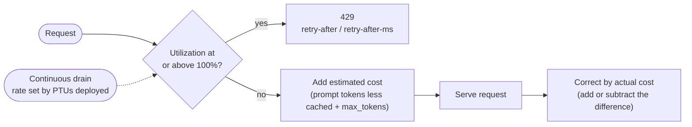

# Part 4 — PTU throttling, "hourly" billing, and how long to wait after a 429

> **Scope:** three questions that come up when designing PTU → TPM failover ([Part 2](Part%202-PTU-to-TPM-Failover-Options.md)):
> *is PTU throttling a sliding window?*, *what does "hourly" mean for a PTU?*, and *how long should a client wait after a `429`?* The first two are answered by two
> unrelated mechanisms — a **rate-enforcement algorithm** and a **billing unit** — and mixing them up leads to
> wrong failover assumptions. The third depends on *why* the `429` happened, which differs between PTU and Standard.
>
> Checked against Microsoft Learn on 2026-10-12; sources are listed at the end. Statements that are my own
> analysis rather than Microsoft's are marked **Analysis**.

---

## Short version

| Question | Answer |
|---|---|
| Is PTU throttling a sliding window? | **No.** Microsoft documents it as a *variation of the leaky bucket algorithm*. |
| What is "hourly"? | A **billing and reservation-matching unit**. It has nothing to do with when a `429` is returned. |
| Is hourly billing based on usage? | **No.** It is based on the **PTUs deployed**, whether or not any request arrives. |
| Does a reservation change throttling? | **No.** It is a discount on the billing meter, not a change in capacity. |
| How long should I wait after a PTU `429`? | The time in `retry-after-ms` (milliseconds) or `retry-after` (seconds). Microsoft gives no fixed value. For the lowest latency, redirect to another deployment instead of waiting. |
| Is that the same for a Standard (TPM) `429`? | The core rule is the same (honor `retry-after-ms`), but a Standard `429` has several possible causes and some do not clear with a short wait. See [§3](#3-retrying-a-429-how-long-to-wait). |

---

## 1. Throttling: a leaky bucket, not a sliding window

Provisioned deployments evaluate every request individually (prompt size, expected generation size, model) to
determine its expected utilization. Microsoft contrasts this with standard deployments, which use custom rate limiting. Microsoft's description of the logic:

1. **Throttle at 100%.** If current utilization is at or above 100%, the service returns `429` immediately, with
   `retry-after-ms` and `retry-after` headers saying how long to wait.
2. **Estimate the request.** Otherwise the service estimates the cost from the prompt tokens (less any cached
   tokens) plus the `max_tokens` in the call, and adds it to utilization. If `max_tokens` is omitted, the service
   estimates a value.
3. **Correct after completion.** When the request finishes, the real cost is known: if actual exceeds the estimate,
   the difference is added to utilization; if it is lower, the difference is subtracted.
4. **Drain continuously.** Overall utilization is decremented at a continuous rate based on the number of PTUs
   deployed.

Calls are accepted until utilization reaches 100%. Bursts just over 100% might be permitted for short periods, but
over time traffic is capped at 100%.

A `429` from a provisioned deployment is a traffic-management signal, not a service error — the fast failure is what
lets a gateway redirect, spill over, or retry.

### What this means in practice

- **`max_tokens` moves the 429 point.** The estimate uses `max_tokens` up front, so a large or omitted value reserves
  more of the bucket than the request ends up using. Microsoft advises setting it close to the true generation size
  for the highest concurrency.
- **Cached prompt tokens reduce the estimate.** Cached tokens can receive up to a 100% discount on the prompt side.
- **The metric is a reporting view.** *Provisioned-managed utilization V2* is defined as PTUs consumed divided by PTUs
  deployed over the period and is reported in one-minute increments. Microsoft does not state that it equals the
  instantaneous bucket level the service enforces against.

### How it differs from the other layers in a failover design

| Layer | Algorithm | Unit counted |
|---|---|---|
| PTU deployment | Variation of leaky bucket | Estimated compute cost per request, corrected by actual |
| Standard (TPM) deployment | Custom rate limiting. TPM is a running estimated-token count that resets each minute; RPM is evaluated over short windows. Can return `429` before quota is exceeded if traffic is uneven | Estimated tokens (prompt + `max_tokens` + `best_of`) and requests; request rate is checked over 1 or 10 second intervals |
| APIM `llm-token-limit` | Sliding window on classic tiers, token bucket on v2 tiers | Prompt and completion tokens, tracked **per gateway** |

**Analysis:** because the gateway counter uses a different algorithm and a different unit from the PTU bucket, it can
only approximate PTU headroom. That is why [Part 2, Scenario 4](Part%202-PTU-to-TPM-Failover-Options.md#scenario-4--token-budget-assisted-routing-proactive-not-a-standalone-router)
is framed as a pre-emptive *signal* that still needs a `429` retry as a backstop.

---

## 2. "Hourly": a billing unit, not a throttling window

### Hourly billing

- Provisioned deployments (Regional, Data Zone, Global) are charged at an hourly rate in **$/PTU/hr** multiplied by
  the **PTUs deployed**. A 300 PTU deployment is charged at the hourly rate × 300.
- The charge applies **whether or not the deployment is handling requests**. It is not based on tokens consumed.
- Partial hours are prorated: a deployment that exists for 15 minutes is charged 1/4 of the hourly rate.
- Resizing takes effect immediately and is prorated to the minute.

### Reservations

A reservation is a discount on the hourly PTU meter, committed for a 1-month or 1-year term. It is applied by an
**hourly comparison** between reserved PTUs and deployed PTUs:

- Deployed PTUs **up to the reserved quantity** are covered by the reservation.
- Deployed PTUs **above** the reserved quantity are billed at the hourly rate.
- Reserved quantity **not matched** by a running deployment is unused and still paid for.
- Partial-hour deployments are prorated by minutes: a 100 PTU deployment that exists for 15 minutes of an hour counts
  as 25 PTUs for that hour.
- A reservation of 64 covers up to 64 deployed PTUs every hour.
- Matching uses deployment type, region (for Data Zone and Regional; Global reservations are not region-specific),
  and scope — not model or deployment ID.
- A reservation does not guarantee capacity, and resizing a deployment does not change the reserved quantity.

### What the documentation does not say

- Whether the "hour" is **clock-aligned** or **rolling from deployment creation**. "Hour period" suggests the clock
  hour, but that is an inference.
- Whether the Azure Monitor utilization metric is **identical** to the enforced bucket level.
- The **drain rate** per PTU. Microsoft publishes sizing guidance per model, not the bucket parameters.

---

## 3. Retrying a 429: how long to wait

**The rule:** wait as long as the service asks. Microsoft publishes no fixed wait time for either deployment type — the
header is the source of truth, and the right action depends on *why* the `429` happened.

### 3.1 PTU deployment `429`

A PTU `429` has one cause: utilization has reached 100% (see [§1](#1-throttling-a-leaky-bucket-not-a-sliding-window)).
It carries `retry-after-ms` and `retry-after`, which say how long until the next call is accepted. Microsoft's options:

1. **Redirect to another deployment or model.** This adds the least latency because you act as soon as the `429`
   arrives. [Spillover](https://learn.microsoft.com/azure/foundry/openai/how-to/spillover-traffic-management)
   automates it.
2. **Retry after the header wait.** Use this if you need the PTU and can tolerate added latency.

Microsoft's Well-Architected guidance for Azure OpenAI differentiates by workload tier:

| Workload | Guidance |
|---|---|
| Interactive | Fail fast. Retry **once** after `retry-after-ms`; if still throttled, return a degraded but useful response rather than holding the request open. |
| Batch | Enqueue the failed work durably and resume after the retry window. Don't hold threads. |
| Background | Accept a longer delay. Use exponential backoff with jitter bounded within the retry window, and annotate each attempt with `retry-attempt`. |

Also documented:

- Surface the `429` and its retry headers upstream. Absorbing it into a generic `500` strips the retry guidance and
  can turn a recoverable condition into a retry storm.
- A `408` (PTU queue timeout) is also retryable, with backoff or a route to a spillover deployment.
- The OpenAI SDKs retry `429` by default and respect `retry-after`. The Python default is 2 retries (`max_retries`),
  and you can raise it or set it to `0`.

### 3.2 Standard (TPM) deployment `429`

Microsoft states that **not all Standard `429`s have the same root cause**, and that many customers misread a capacity
`429` as a quota problem. Read the error message and headers first.

| Cause | Indicator | Wait and action |
|---|---|---|
| TPM exceeded | "Requests to … have been limited" or "Rate limit is exceeded" | The `429` lasts until the token counter resets, which happens each minute. Occasional `429`s: retry per `retry-after-ms`. Sustained: raise the deployment's TPM, rebalance quota, or request an increase. |
| RPM burst | Same message, even though the per-minute total is within the limit | The `429` lasts until the next evaluation period, typically 1 or 10 seconds. Spread requests evenly and ramp new load gradually. |
| System capacity | "The service is temporarily unable to process your request" or "System is experiencing high demand" | Often transient. Retry after `retry-after-ms`. More quota will not fix it; if persistent, consider PTU. |
| Temporary rate-limit reduction | `x-ratelimit-limit-tokens` is lower than the TPM you configured | Retry with `retry-after-ms` backoff, but Microsoft says this typically resolves **within a few hours**, so also spread traffic across deployments or regions. |
| `max_tokens` overestimate | `429`s while token usage metrics look low | Lower `max_tokens` to the expected response size. |

**Analysis:** because the TPM counter resets each minute, a pure TPM overrun should clear within about a minute.
Microsoft does not state that as a wait time.

Also documented for Standard:

- **Headers on every response:** `x-ratelimit-limit-*`, `x-ratelimit-remaining-*` and `x-ratelimit-reset-*` (for
  requests and tokens), plus `retry-after-ms` on a `429`. Watch the `remaining` headers to slow down before you get a
  `429`, and compare `x-ratelimit-limit-tokens` with your configured TPM to spot a temporary reduction.
- **No header:** use exponential backoff with random jitter and cap the attempts (the quota article suggests, for
  example, 5–10).
- **Rejected requests count.** Failed requests count toward your limit, so retrying without waiting keeps you throttled.
- **Retry in one place.** The OpenAI Python SDK retries twice by default. If you add your own retry loop, set
  `max_retries=0`, or each of your attempts becomes three requests.

When to retry versus escalate:

| Situation | Action |
|---|---|
| Occasional `429`s that clear after `retry-after-ms` | Retry — normal for shared Standard deployments. |
| `429`s in development or test | Often acceptable; they can be intentional cost guardrails. |
| Sustained `429`s in production while below your approved quota | Escalate with a support request. |
| A limit increase that is not reflected in the effective limit | Verify the deployment-level allocation, then escalate. |
| Frequent `429`s on latency-critical production workloads | Consider PTU for guaranteed capacity. |

### 3.3 Side by side

| | PTU deployment | Standard (TPM) deployment |
|---|---|---|
| Cause of a `429` | Utilization at 100% | TPM or RPM exceeded, system capacity, temporary limit reduction, or `max_tokens` overestimate |
| Retry headers documented | `retry-after-ms` and `retry-after` | `retry-after-ms`, plus `x-ratelimit-*` limit, remaining and reset headers |
| How long the `429` lasts | Until utilization drains below 100% | Until the minute counter resets (TPM), the next 1–10 second window (RPM), a transient capacity condition, or up to a few hours for a temporary limit reduction |
| Fallback with no header | Not specified in the PTU pages reviewed | Exponential backoff with random jitter, capped attempts |
| Proactive signal | Utilization metric, reported per minute | `x-ratelimit-remaining-*` on every response |
| Redirect option | Spillover or another deployment (lowest latency) | Spread across deployments or regions |
| Same in both | Honor `retry-after-ms`; keep `max_tokens` close to what you need; retry in one place | |

### 3.4 In this design: APIM and spillover

- **`<retry>` interval.** The APIM `<retry>` policy requires `interval` to be a positive number of seconds, so it cannot
  express a sub-second `retry-after-ms`. `first-fast-retry` is right only when the retry targets a *different*
  deployment. `interval` accepts policy expressions, so it could be derived from the `retry-after` header in seconds;
  Microsoft does not document sub-second values.
- **Circuit breaker.** `acceptRetryAfter: true` honors the standard `Retry-After` header. Microsoft does not document it
  consuming `retry-after-ms`, and warns that Azure OpenAI's `Retry-After` can be very large (for example, one day).
- **Spillover end of the line.** If the Standard deployment also fails to serve a spilled request, its response (status
  and body) is returned to the caller with `x-ms-spillover-from-deployment` and `x-ms-spillover-error` still present.
  Apply the Standard guidance in [§3.2](#32-standard-tpm-deployment-429) to that response.
- **Analysis:** cap how long a caller will wait. A large `Retry-After`, or a temporary Standard limit reduction that lasts
  hours, is better handled by queueing or failing the request than by holding a connection open.

---

## 4. Implications for PTU → TPM failover

**Analysis** — these follow from the facts above and are not statements from Microsoft.

1. **Routing around a PTU does not reduce its bill.** Billing follows deployed PTUs, so every minute traffic bypasses
   the PTU is capacity paid for and unused. Overflow served by a Standard deployment is billed separately per token.
   See [Part 2, Appendix B](Part%202-PTU-to-TPM-Failover-Options.md#appendix-b--how-reservations-factor-into-the-cost).
2. **Hourly billing and throttling are independent.** Buying a reservation does not raise the 100% ceiling, and
   scaling a deployment changes both the ceiling and the bill, but through different mechanisms.
3. **Pre-emptive routing on the metric lags.** The metric is reported in one-minute increments while the bucket reacts
   per request, so [Scenario 5](Part%202-PTU-to-TPM-Failover-Options.md#scenario-5--utilization-metric-driven-routing)
   should shift sustained imbalance and leave bursts to a reactive mechanism.
4. **Control `max_tokens` before tuning failover.** An inflated or omitted `max_tokens` makes the PTU return `429`
   earlier than the real workload would, which triggers failover more often and sends more traffic to pay-per-token.
5. **Do not model the PTU as a per-minute quota.** Counting tokens per minute at the gateway (as `llm-token-limit`
   does) will not reproduce when the PTU throttles.

---

## Sources

- [Operate provisioned deployments in production](https://learn.microsoft.com/azure/foundry/openai/how-to/provisioned-get-started) — "How utilization works", the utilization metric, handling `429`
- [What is provisioned throughput for Foundry Models?](https://learn.microsoft.com/azure/foundry/openai/concepts/provisioned-throughput) — leaky bucket description, contrast with standard rate limiting
- [Provisioned throughput billing and cost management](https://learn.microsoft.com/azure/foundry/openai/concepts/provisioned-throughput-billing) — hourly billing, proration, reservations
- [Save costs with Microsoft Foundry Provisioned Throughput Reservations](https://learn.microsoft.com/azure/cost-management-billing/reservations/microsoft-foundry) — hourly comparison, partial-hour proration, matching
- [Limit large language model API token usage](https://learn.microsoft.com/azure/api-management/llm-token-limit-policy) — sliding window vs token bucket, per-gateway counters
- [Azure OpenAI 429: token and request rate limits explained](https://learn.microsoft.com/microsoft-cloud/dev/dev-proxy/concepts/azure-openai-429-token-rate-limit) — standard deployment `429` causes, headers, rejected requests count toward limits
- [LLM rate limits: tokens per minute, requests per minute, and what happens when you hit them](https://learn.microsoft.com/microsoft-cloud/dev/dev-proxy/concepts/llm-rate-limits) — wait for the header, backoff fallback, SDK retries
- [Manage Azure OpenAI quota](https://learn.microsoft.com/azure/foundry/openai/how-to/quota) — TPM counter and RPM windows, rate limit headers, `429` types, retry versus escalate
- [Design throttling to improve resilience](https://learn.microsoft.com/azure/well-architected/design-guides/throttling) — interactive, batch and background retry guidance, `408` handling
- [Manage traffic with spillover for provisioned deployments](https://learn.microsoft.com/azure/foundry/openai/how-to/spillover-traffic-management) — spillover redirect, response when the Standard deployment also fails
- [Retry policy](https://learn.microsoft.com/azure/api-management/retry-policy) and [Backends in API Management](https://learn.microsoft.com/azure/api-management/backends) — `interval` rules, circuit breaker `acceptRetryAfter`, large `Retry-After` caution
