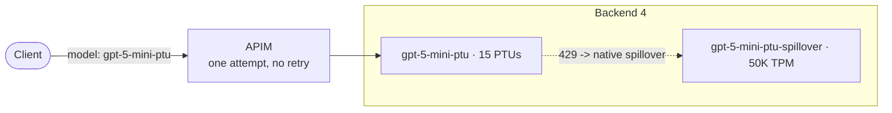

# Use case 4: PTU to Foundry spillover on backend 4

This is the customer-facing story behind phase 4 of [invoke-lab.ps1](invoke-lab.ps1): a provisioned (PTU) deployment runs out of capacity, **Foundry itself** serves the overflow from a standard deployment, and **API Management (APIM) does nothing**. This file holds everything about backend 4. The routing pool, the other three backends and the other phases are in [README.md](README.md).

## The use case

A customer pays for provisioned capacity and wants the overflow to be handled without any gateway logic: no retries, no circuit breaker, no second backend. Foundry's native spillover does this. When the PTU deployment would return `429`, Foundry serves the request from a standard (pay-per-token) deployment on the same resource and returns a `200` to the caller.

The demo shows three things:

1. The PTU was exhausted.
2. The request was served by the spillover deployment.
3. APIM did nothing. It made one attempt, never saw a `429`, and never retried.

## Architecture

Backend 4 is a separate Foundry account with one 15-PTU deployment, `gpt-5-mini-ptu`, whose `spilloverDeploymentName` points at `gpt-5-mini-ptu-spillover` on the same resource. It is **not** in the routing pool and has no circuit breaker.



| Deployment | SKU | Capacity | Why |
|---|---|---|---|
| `gpt-5-mini-ptu` | `GlobalProvisionedManaged` | **15 PTUs** | The documented minimum for global provisioned `gpt-5-mini`; confirm it is still current in [PTU sizing](https://learn.microsoft.com/azure/foundry/openai/how-to/provisioned-throughput-sizing) |
| `gpt-5-mini-ptu-spillover` | `GlobalStandard` | 50 (50K TPM) | Large enough that the demo's small requests never use it up, unlike the deliberately tiny spillover on backends 1 and 2 |

The account, deployments and spillover link are defined in [params.json](params.json), and the routing is in [policy.xml](policy.xml).

## What goes through APIM, and what does not

Phase 4 sends two different kinds of traffic to backend 4:

| Traffic | Goes through APIM? | Where it goes |
|---|---|---|
| **The requests under test**: 12 small requests per round, 36 in a default run | **Yes** | Always to backend 4's `gpt-5-mini-ptu` deployment |
| **The saturating prompts**: large unique prompts that exhaust the PTU | **No** | Straight to backend 4's Foundry endpoint |
| **The saturation probes**: one small request at a time, to detect when the PTU is full | **No** | Straight to backend 4's Foundry endpoint |

The direct traffic stands in for other consumers using the same PTU. It bypasses APIM on purpose: if the saturating prompts went through APIM, APIM would see their `429`s, and you could no longer show that APIM never knew the PTU was exhausted.

## How the requests under test are routed

- **Only backend 4's PTU is addressed.** The policy routes the model `gpt-5-mini-ptu` to backend 4. It never touches the routing pool, backends 1 to 3, or their circuit breakers.
- **APIM never names the spillover deployment.** Foundry moves a request to `gpt-5-mini-ptu-spillover` on its own when the PTU returns `429`.
- **Each request is one attempt.** The policy does not retry this route, so any recovery you see is Foundry's.
- **The requests are small.** The spillover deployment has a finite quota, and small requests use only a few hundred tokens in total, so the spillover is never exhausted and callers get `200`s, not `429`s.

## Prerequisites

- `GlobalProvisionedManaged` quota of **15 PTUs** for backend 4. It shares `eastus2` with backend 1, so that region needs 30 PTUs in total.
- Your Azure CLI identity needs data-plane access to the Foundry account, for example the `Cognitive Services OpenAI User` role. The Owner and Contributor roles do not grant data-plane access.
- Your machine must be able to resolve the account's host name. On networks with DNS filtering, a newly created account name can fail to resolve for a while. The script checks first and stops with a clear message if it cannot.

Provisioned capacity is billed while it exists, even when idle.

## Run it

In the notebook, set `phases = "4"` in the **Send traffic** cell. From the command line:

```powershell
.\labs\verify-routing-path\invoke-lab.ps1 -GatewayUrl $outputs.gatewayUrl.value -Phase 4
```

`-SpilloverRounds` (default 3) is how many times to saturate the PTU, and `-SpilloverRequestsPerRound` (default 12) is how many small requests to send through APIM each time. Phase 4 runs only when the `FOUNDRY_PRIME_TARGETS` environment variable has an entry for backend 4. The notebook sets it for you. It is a JSON array of `{ name, endpoint, token }`, and it uses an Entra ID token because key-based authentication may be disabled on the account. Phase 4 does not touch the pool or its circuit breakers, so it can run at any time.

### What each round does

Rounds 1, 2 and 3 are identical repeats, not different steps. Each round runs this sequence:

1. **Saturate the PTU.** A background job sends 6 large, unique prompts in parallel straight to backend 4's Foundry endpoint (`-PrimeRequestsPerBackend`, default 6; `-PrimePromptRepeat`, default 15000 repeats of a sentence). They bypass APIM, so they stand in for the PTU's other consumers.
2. **Confirm saturation.** For up to 25 seconds, the script sends a tiny direct request ("Reply with only the word ok.") every 250 ms. As soon as one comes back with the `x-ms-spillover-from-deployment` header, the PTU is confirmed full. The script logs how many seconds that took, or `PTU did not saturate` if it never happened. The probes use almost none of the spillover quota.
3. **Send the requests under test.** With the PTU full, the script sends 12 small requests concurrently through APIM, each with its own `spill-<guid>` ID in the `x-client-request-id` header.
4. **Tally the round.** It waits for the priming job to finish, then counts the APIM requests served by spillover, served by the PTU, and rejected with a `429`.

Between rounds it waits 5 seconds so the PTU can drain before the next one.

Several rounds are used because the PTU saturates a few seconds after the priming starts, so a single round could miss the window. Three rounds send 36 requests (3 × 12) through APIM and show that the behavior is consistent, not a one-off.

The round summary lines come from a real run. Each shows when the PTU saturated, what the direct priming requests returned, and how the APIM requests were served:

```text
  Round 1: PTU saturated after 5.2 s; priming responses [3 x 200, 3 x 429]. Through APIM: 12 served by spillover, 0 by the PTU, 0 x 429
  Round 2: PTU saturated after 3.1 s; priming responses [6 x 429]. Through APIM: 5 served by spillover, 7 by the PTU, 0 x 429
  Round 3: PTU saturated after 6.2 s; priming responses [1 x 200, 5 x 429]. Through APIM: 12 served by spillover, 0 by the PTU, 0 x 429
```

Rounds can differ. In round 2 above, 7 of the 12 requests were served by the PTU itself. The PTU's headroom changes second by second as the priming requests finish, so some requests can land while it has capacity. That is why the script uses several rounds, and why the proof is the per-request `x-ms-spillover-from-deployment` header, not the round's saturation message. Either way, there are no `429`s and no APIM retries.

After the last round the script prints the combined results. In most runs every request is served by the spillover deployment, with zero `429`s, zero APIM retries, and under a thousand spillover tokens used. In 4 of the 5 runs checked, all 36 requests spilled over:

```text
Phase 4 results (36 requests through APIM to backend 4):
   36  200 served by the Foundry spillover deployment (gpt-5-mini-ptu -> gpt-5-mini-ptu-spillover)
    0  200 served by the PTU deployment
    0  429 (spillover quota exhausted)
  APIM retries: 0 (every request was a single APIM attempt)
  Spillover tokens used: 864
```

Occasionally some requests are served by the PTU itself, as in round 2 above. That run's totals were:

```text
Phase 4 results (36 requests through APIM to backend 4):
   29  200 served by the Foundry spillover deployment (gpt-5-mini-ptu -> gpt-5-mini-ptu-spillover)
    7  200 served by the PTU deployment
    0  429 (spillover quota exhausted)
  APIM retries: 0 (every request was a single APIM attempt)
  Spillover tokens used: 696
```

Both outcomes are correct. The script counts a request as spilled over only when the response carries Foundry's `x-ms-spillover-from-deployment` header, and APIM's telemetry for the same requests agrees with the script's counts. The `0 PTU` result is the usual one because the script sends the requests under test only after it has seen the PTU saturate, so they normally arrive while it is still full.

## What the telemetry shows

Run [telemetry-spillover.kql](telemetry-spillover.kql) in the Log Analytics workspace, not the Application Insights resource (see [README.md](README.md#read-the-telemetry)). It needs no request ID: it reads every request whose ID starts with `spill-`. Widen or narrow the `2h` window in the queries to match when you ran the demo.

In most runs, every request under test is rejected by the PTU, served by the spillover deployment, and returned to the caller as a `200`. If a round shows some requests served by the PTU itself, those rows have `served_deployment` of `not-reported` and `spillover_from` of `none` in the trace. Query 2a counts them as `gpt-5-mini-ptu (the PTU itself)`, and query 0 shows `ServedBySpillover` lower than `Requests`. The three answers below then apply to the requests that spilled over:

| Question | Where the proof is |
|---|---|
| 1. The PTU was exhausted | Per request, Foundry's `x-ms-spillover-error: 429` header says the provisioned deployment returned 429 (query 1a). Azure Monitor shows the rejections per minute (query 1b). |
| 2. Served by the spillover | `x-ms-deployment-name` names `gpt-5-mini-ptu-spillover`, and the caller got a `200` (queries 2a, 2b and 2c). |
| 3. APIM did nothing | One attempt per request (query 3a), and APIM's own dependency telemetry shows backend 4 returning only `200`s and no `429` (query 3b). |

Query 0 is a one-row scorecard of all three. Query 2b lists every request one by one, and query 2c lists only the requests that went to the PTU first and were served by the spillover deployment. Query 3b has a `NoResponse` column that counts calls that never completed, so the numbers add up.

Query 1b also shows the platform utilization metrics. In this lab the legacy `AzureOpenAIProvisionedManagedUtilization` metric rose above 100% during the burst, while the recommended V2 metric peaked lower, so treat the per-request header in 1a as the authoritative proof of exhaustion.

## Where the telemetry data comes from

**APIM writes everything in `AppTraces` and `AppDependencies`. Foundry writes nothing to either table.**

1. [policy.xml](policy.xml) contains `<trace>` statements: `routing-request-start` in `<inbound>`, and one `routing-attempt-complete` per APIM attempt at a backend.

```
    <trace source="verify-routing-path" severity="information">
        <message>routing-attempt-complete</message>
        <metadata name="client_request_id" value="@((string)context.Variables[&quot;clientRequestId&quot;])" />
        <metadata name="attempt" value="@(((int)context.Variables[&quot;attempt&quot;]).ToString())" />
        <metadata name="status_code" value="@(context.Response.StatusCode.ToString())" />
        <metadata name="request_host" value="@(context.Request.Url.Host)" />
        <metadata name="served_deployment" value="@(context.Response.Headers.GetValueOrDefault(&quot;x-ms-deployment-name&quot;, &quot;not-reported&quot;))" />
        <metadata name="spillover_from" value="@(context.Response.Headers.GetValueOrDefault(&quot;x-ms-spillover-from-deployment&quot;, &quot;none&quot;))" />
        <metadata name="spillover_error" value="@(context.Response.Headers.GetValueOrDefault(&quot;x-ms-spillover-error&quot;, &quot;none&quot;))" />
        <metadata name="retry_after" value="@(context.Response.Headers.GetValueOrDefault(&quot;Retry-After&quot;, &quot;none&quot;))" />
        <metadata name="serving_region" value="@(context.Response.Headers.GetValueOrDefault(&quot;x-ms-region&quot;, &quot;not-reported&quot;))" />
    </trace>
```

2. The API-level diagnostic in [inference-api.bicep](../../modules/apim/v3/inference-api.bicep) sends them through the `appinsights-logger` with `verbosity: 'verbose'`. That verbosity is required for `<trace severity="information">` to be emitted.
3. They go to Application Insights, which is workspace-based, so they appear in the Log Analytics workspace as `AppTraces`. APIM's own backend calls appear as `AppDependencies`.

| Evidence | Produced by | Table |
|---|---|---|
| `x-ms-spillover-from-deployment`, `x-ms-spillover-error`, `x-ms-deployment-name` response headers | **Foundry**, added to the response when it spills over | Not stored by Foundry. APIM's trace copies them into `Properties`, which is why queries read `served_deployment`, `spillover_from` and `spillover_error` from `AppTraces`. |
| `routing-attempt-complete` traces (one row per APIM attempt) | **APIM**, from the policy | `AppTraces` |
| Backend calls and their result codes | **APIM**, from its own dependency telemetry | `AppDependencies` |
| `ClientErrors`, `AzureOpenAIRequests`, utilization | **Foundry** platform metrics, per minute | `AzureMetrics` |

What this means when you present it:

- **The headers are Foundry's word; the rows are APIM's record.** The `AppTraces` rows are APIM reporting what Foundry told it. APIM is the recorder, not the source of the spillover evidence.
- **"APIM did nothing" is APIM's own record of its own actions.** Query 3a (one trace row per request) and query 3b (only `200`s, no `429`) both come from APIM, and they are consistent with the headers.
- **Only query 1b is independent of APIM.** `AzureMetrics` comes from the Foundry account itself, so it does not depend on the gateway policy.
- **Only requests that went through APIM leave `AppTraces` rows.** The saturating prompts and the probes go straight to Foundry, so they appear only in `AzureMetrics`. That is why the queries filter on `client_request_id` starting with `spill-`.

## Behavior to know about

- **Backend 4's PTU saturates a few seconds after the priming starts, and only for a few seconds.** Phase 4 therefore probes for the spillover header and sends its requests the moment the PTU reports saturation, instead of using a fixed delay. Some requests in a round can still land after the window and be served by the PTU itself.
- **Rarely, a request gets no response.** In testing, 2 of about 180 calls to backend 4 had no response for about 60 seconds until the test client gave up. APIM was waiting for Foundry. It happened with and without saturation, so it is unrelated to spillover. The demo client times out after 30 seconds.
- **A failed DNS lookup can stop the saturation.** If this machine cannot resolve the account's host name mid-run, the priming requests never reach Foundry, the PTU does not saturate, and the requests are served by the PTU instead. The script warns when priming requests never reached Foundry.

## Alternative: saturate through APIM too

You can send the saturating prompts through APIM as well. The demo would still work, but APIM would then log `429`s from the oversized prompts, because the spillover deployment cannot absorb them. That weakens the "APIM did nothing" evidence, so the script keeps the saturation direct.
