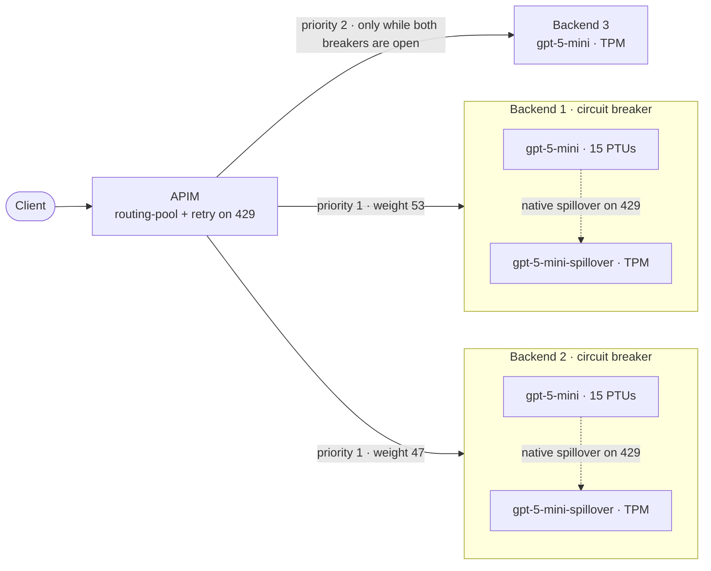
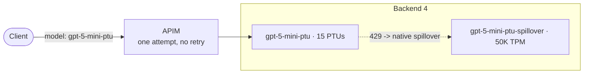

# Verify routing path

Three Microsoft Foundry backends behind Azure API Management (APIM). The lab shows, with real traffic and telemetry, how one request is serviced as backends saturate. A fourth, separate backend demonstrates Foundry-native spillover; see [Backend 4](#backend-4-ptu-to-foundry-spillover).



## How a request is routed

1. About 53% of requests start on backend 1 and 47% on backend 2.
2. If the PTU deployment returns `200`, that response goes straight back to the caller.
3. If the PTU deployment returns `429`, **Foundry** sends the request to the TPM deployment on the same resource (`spilloverDeploymentName`). APIM is not involved in that hop.
4. If that TPM deployment also returns `429`, APIM receives the `429`, the backend's circuit breaker trips, and APIM's `<retry>` re-forwards the request to the pool. The pool skips the tripped backend and uses the other priority-1 backend.
5. When both priority-1 breakers are open, the pool uses backend 3.
6. If backend 3 returns `429` too, the caller receives that `429` after 3 attempts.

The policy is in [policy.xml](policy.xml). The pool and breakers are created by [main.bicep](main.bicep) from [params.json](params.json).

### One deployment name everywhere

Backends 1 and 2 expose the PTU deployment as `gpt-5-mini`, and backend 3 exposes its TPM deployment under the same name. A pool hands the identical request to whichever backend it picks, so the policy never rewrites the model. The spillover targets (`gpt-5-mini-spillover`) are never addressed by APIM.

### Sizing

| Deployment | SKU | Capacity | Why |
|---|---|---|---|
| `gpt-5-mini` on backends 1 and 2 | `GlobalProvisionedManaged` | **15 PTUs** | The documented minimum for global provisioned `gpt-5-mini`; confirm it is still current in [PTU sizing](https://learn.microsoft.com/azure/foundry/openai/how-to/provisioned-throughput-sizing) |
| `gpt-5-mini-spillover` on backends 1 and 2 | `GlobalStandard` | 1 (1K TPM) | Deliberately tiny so the spillover can actually be exhausted |
| `gpt-5-mini` on backend 3 | `GlobalStandard` | 20 (20K TPM) | The last-resort backend |

## Backend 4: PTU to Foundry spillover

Backend 4 is a separate Foundry account with one 15-PTU deployment whose overflow Foundry spills to a standard deployment on the same resource. It is outside the routing pool and has no circuit breaker, and APIM never retries it, so any spillover is Foundry's doing alone. Phase 4 of the script demonstrates it. Its sizing, test, telemetry and caveats are in [README-UseCase 4.md](<README-UseCase 4.md>).



## Prerequisites and cost

- Azure CLI with Bicep, and PowerShell 7 (`pwsh`)
- Permission to create APIM, Application Insights, Log Analytics and Foundry resources
- `GlobalProvisionedManaged` quota of **15 PTUs for each PTU deployment, 45 in total**: `eastus2` hosts backends 1 and 4 (30 PTUs) and `swedencentral` hosts backend 2 (15 PTUs). You also need Global Standard quota in those regions.
- `gpt-5-mini` version `2025-08-07` available in those regions
- For phases 3 and 4, your Azure CLI identity needs data-plane access to the Foundry accounts, for example the `Cognitive Services OpenAI User` role. The Owner and Contributor roles do not grant data-plane access. Your machine must also be able to resolve the accounts' host names. On networks with DNS filtering, a newly created account name can fail to resolve for a while, and the script stops with a clear message if so.

**Provisioned deployments are billed while they exist, even when idle.** The lab runs three of them. Deploy for the test and delete the resource group right afterwards.

## Deploy and run

The easiest path is [verify-routing-path.ipynb](verify-routing-path.ipynb): set the resource group name, run the cells top to bottom, and run the guarded cleanup cell at the end.

To use the command line instead:

```powershell
$resourceGroup = "lab-verify-routing-path"
az group create --name $resourceGroup --location eastus2
az deployment group create `
  --resource-group $resourceGroup `
  --name verify-routing-path `
  --template-file .\labs\verify-routing-path\main.bicep `
  --parameters .\labs\verify-routing-path\params.json

$outputs = az deployment group show -g $resourceGroup -n verify-routing-path --query properties.outputs | ConvertFrom-Json
$env:APIM_SUBSCRIPTION_KEY = $outputs.subscriptionKey.value
.\labs\verify-routing-path\invoke-lab.ps1 -GatewayUrl $outputs.gatewayUrl.value
```

Re-running the deployment applies policy and parameter changes; it is idempotent.

[invoke-lab.ps1](invoke-lab.ps1) runs four phases. A full run takes a few minutes. Choose what runs with `-Phase`, which accepts `all` (the default) or a comma-separated list. Each phase works on its own, so you can demo them one at a time:

```powershell
.\labs\verify-routing-path\invoke-lab.ps1 -GatewayUrl $outputs.gatewayUrl.value -Phase 1     # weighted baseline only
.\labs\verify-routing-path\invoke-lab.ps1 -GatewayUrl $outputs.gatewayUrl.value -Phase 2     # pressure burst only
.\labs\verify-routing-path\invoke-lab.ps1 -GatewayUrl $outputs.gatewayUrl.value -Phase 4     # backend 4 PTU -> spillover only
.\labs\verify-routing-path\invoke-lab.ps1 -GatewayUrl $outputs.gatewayUrl.value -Phase 1,3   # baseline and guaranteed traveler
```

In the notebook, set `phases` in the **Send traffic** cell (for example `"2"`, `"4"` or `"1,3"`). Circuit breakers stay open for 30-60 seconds after a `429`, so wait about a minute between separate phase 2 and phase 3 runs.

1. **Weighted baseline** (`-WeightedRequestCount`, default 200): small requests, 8 at a time. This is where the 53/47 split shows up.
2. **Pressure burst through APIM** (`-PressureRequestCount`, default 16; `-SmallRequestCount`, default 24): large unique prompts of roughly 90K tokens saturate both PTUs, with small requests spread across the first seconds. Unique prompt prefixes stop prompt caching from discounting the PTU load. The prompts consume PTU capacity, not extra per-token charges; only requests that spill to or fall back to a TPM deployment are billed per token, and the oversized ones are rejected there. This shows the organic mix of outcomes. The run prints a `Traveler request ID` if a request completed backend 1 -> 2 -> 3 with a `200`. Whenever a request used all of its attempts and still got a `429`, it also prints a `Rejected request ID`, which you can paste into [telemetry.kql](telemetry.kql) to see each backend that request tried.
3. **Guaranteed traveler** (`-TravelerCycles`, default 6): a request can only walk backend 1, 2, then 3 when both PTUs are saturated and neither circuit breaker has tripped. Overload sent through APIM trips the breakers, so this phase saturates both PTUs **directly**, bypassing APIM, like another consumer of the same Foundry resources. It probes until both PTUs report saturation, then sends one tracer through APIM. The tracer reserves 2,000 tokens, which exceeds the 1K-TPM spillover quota, so native spillover cannot rescue it. The phase repeats until a tracer walks backend 1 -> 2 -> 3, because the first hop is weighted and a tracer can also walk 2 -> 1 -> 3.

4. **Spillover demo on backend 4:** PTU to Foundry-native spillover on a separate backend, outside the pool. See [README-UseCase 4.md](<README-UseCase 4.md>).

Phases 3 and 4 run only when the `FOUNDRY_PRIME_TARGETS` environment variable is set; the notebook sets it for you. It is a JSON array of `{ name, endpoint, token }` for the Foundry accounts, and it uses an Entra ID token because key-based authentication may be disabled on the accounts. Phase 3 uses backends 1 and 2.

The policy returns an `x-routing-path` header, for example `route-backend-1>route-backend-2>route-backend-3`, so the script can classify every response without waiting for telemetry:

```text
Phase 2: pressure burst through APIM (16 large prompts + 24 small requests over 6 s)...
    6  200 after APIM retried on the other priority-1 backend
    3  200 after PTU 429 -> native TPM spillover (APIM not involved)
    2  200 after trying both priority-1 backends, then backend 3
    7  200 from backend 3 directly (both priority-1 breakers were already open)
   15  200 from the first backend's PTU
    1  200 on backend 3 after one failed attempt (other breaker was already open)
    6  429 returned to caller after 3 attempt(s)

This request tried every backend but was rejected (backend 1 -> backend 2 -> backend 3, status 429).
Rejected request ID: pressure-0dd63fab-5a54-41ae-9035-525d7411ea08

Phase 3: saturating both PTUs directly (like another consumer of the same resources), then sending one tracer through APIM...
  Cycle 1: both PTUs saturated after 7.8 s; priming responses [4 x 200, 8 x 429]. Tracer: backend 1 -> backend 2 -> backend 3, status 200

This request tried backend 1 -> backend 2 -> backend 3 and was answered with status 200.
Traveler request ID: tracer-7d2faaa7-43e9-4c10-a29d-b9836167d34c
```

Counts and the number of Phase 3 cycles vary between runs.

## Read the telemetry

In the Azure portal, open the deployed **Log Analytics workspace** (`workspace-<suffix>`, in the same resource group), select **Logs**, and run the queries in [telemetry.kql](telemetry.kql) one at a time. For the backend 4 spillover demo, see [README-UseCase 4.md](<README-UseCase 4.md>). Telemetry usually appears within a few minutes.

Use the workspace, not the Application Insights resource. The queries use the workspace table names `AppTraces` and `AppDependencies`. The Application Insights **Logs** blade shows the same data under the older names `traces` and `dependencies` (with `message`, `customDimensions`, `timestamp` and `operation_Id` in place of `Message`, `Properties`, `TimeGenerated` and `OperationId`), so these queries fail there with "cannot find table AppTraces".

For the traveler above, query 1 returns one row per APIM attempt:

| Attempt | Backend | Status | Served deployment | Spillover from |
|---:|---|---:|---|---|
| 1 | `route-backend-1` | 429 | `gpt-5-mini-spillover` | `gpt-5-mini` |
| 2 | `route-backend-2` | 429 | `gpt-5-mini-spillover` | `gpt-5-mini` |
| 3 | `route-backend-3` | 200 | not reported | none |

- A `served deployment` of `gpt-5-mini-spillover` with `spillover from = gpt-5-mini` shows that Foundry spilled the request internally, in the same single APIM attempt. Here the spillover deployment was exhausted too, so APIM saw the `429` and moved on.
- Foundry returns `x-ms-deployment-name` only when spillover happens. `not reported` means the deployment named in the request answered.
- Query 5 reads APIM's own dependency telemetry for the same request and shows the same three backend calls, which is an independent confirmation.

## Behavior to know about

- **The 53/47 split is an aggregate.** In testing, 400 concurrent requests landed 212 / 188 (53.0% / 47.0%) and 200 landed 106 / 94. A short run from one sequential client can look blocky, for example 30 requests on one backend and then 30 on the other. Judge the split over a few hundred concurrent requests.
- **A PTU `429` is normally invisible to APIM.** Native spillover converts it into a TPM response. APIM only sees a `429` when the spillover deployment is exhausted too, and a spillover `200` never trips a breaker.
- **A breaker trips on the first `429` and reopens after Foundry's `Retry-After`.** Foundry returned `Retry-After: 30`, and in testing the breakers were closed again within 45 seconds. While both priority-1 breakers are open, new requests go straight to backend 3 as a single attempt, so overload sent through APIM mostly produces that outcome. A request walks 1, 2, then 3 only while both PTUs are saturated and neither breaker has tripped, which is why phase 3 saturates the PTUs directly.
- **PTU saturation is brief and delayed.** In testing, a PTU became saturated about 4 to 8 seconds after a set of large prompts started and stayed saturated for only a few seconds. A fixed delay is unreliable, so phase 3 probes for the spillover header instead.
- **Retry re-picking a different pool member is observed, not documented.** Microsoft documents that lower-priority backends are used when every higher-priority backend is tripped. It does not state that a `<retry>` re-forward will pick another pool member after a breaker trips. This lab verified that behavior on a live deployment in October 2026; re-verify it before depending on it.
- **Streaming responses cannot be retried.** Once response headers are flushed, APIM cannot re-issue the request. The retry relies on `buffer-request-body`.
- **Oversized requests may end in `429`.** TPM deployments enforce short-window limits, so a burst of very large prompts can be rejected even by a high-capacity backend 3.

## Clean up

The notebook's cleanup cell deletes the model deployments in each Foundry account first (the resource group deletion does not succeed while they exist), then deletes the resource group, and then purges the soft-deleted API Management service and Foundry accounts so the same resource group name can be redeployed. To do the same from the command line:

```powershell
# Delete the deployments first. Provisioned (PTU) deployments go before the standard deployment they spill over to.
az cognitiveservices account list -g $resourceGroup
az cognitiveservices account deployment list -g $resourceGroup -n <account-name>
az cognitiveservices account deployment delete -g $resourceGroup -n <account-name> --deployment-name <deployment-name>

az group delete --name $resourceGroup --yes

# Deleting leaves the API Management service and the Foundry accounts soft-deleted. Purge them before redeploying
# with the same resource group name. Find the names and locations with the list commands.
az apim deletedservice list
az cognitiveservices account list-deleted
az apim deletedservice purge --service-name <apim-name> --location <location>
az cognitiveservices account purge -g $resourceGroup -n <account-name> -l <location>
```

Purging is permanent. Alternatively, use a new resource group name: the resource names are derived from it, so nothing conflicts.

## References

- [Provisioned throughput sizing](https://learn.microsoft.com/azure/foundry/openai/how-to/provisioned-throughput-sizing)
- [Provisioned deployment spillover](https://learn.microsoft.com/azure/foundry/openai/how-to/spillover-traffic-management)
- [APIM backends, pools and circuit breakers](https://learn.microsoft.com/azure/api-management/backends)
- [APIM retry policy](https://learn.microsoft.com/azure/api-management/retry-policy)
- [APIM trace policy](https://learn.microsoft.com/azure/api-management/trace-policy)
